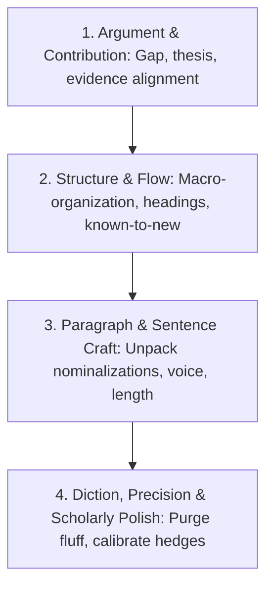

# Clear Academic English – Guidelines and Writing Methodology

This skill adapts the principles of plain language (ISO 24495-1) and international scholarly style guides (APA, Chicago, Nature/Science style guidelines, Day & Gastel, Sword) to academic writing. 

Clear academic writing is **not** about oversimplifying complex theory, erasing disciplinary nuance, or dumbing down rigorous methodology. It is about presenting complex ideas with maximum conceptual clarity, precision, and efficiency, stripping away gratuitous academic jargon, zombie nouns, and impenetrable syntax.

---

## 1. What Is Plain Language in Academia?

> **Operational Definition (ISO 24495-1 adapted for scholarly work):**  
> *Academic communication is clear when peer readers and interdisciplinary scholars can readily locate the core contribution, understand the evidence and reasoning, and evaluate or replicate the findings without cognitive exhaustion.*

High cognitive load should stem from the intellectual novelty of the ideas, **never** from convoluted syntax, defensive obfuscation, or needless abstraction.

---

## 2. The Five Core Principles of Clear Academic Writing

### Principle 1: Know Your Scholarly Audience
- **Define reader scope:** Are you writing for narrow field specialists, a multidisciplinary journal audience (e.g., *Nature*, *PNAS*), or applied practitioners?
- **Calibrate terminology:** Use standardized technical terms when they carry distinct, operationalized meanings. Do not invent idiosyncratic coinages or use esoteric jargon when ordinary words suffice.
- **Explain non-standard terms:** Define new constructs, variables, model assumptions, and acronyms at first mention. Never define one obscure term with another.
- **Bridge across disciplines:** For interdisciplinary or generalist journals, state the broader disciplinary significance before delving into subfield minutiae.

### Principle 2: Clarify Purpose, Research Questions, and Contributions Early
- **State the contribution upfront:** Do not bury your findings or thesis in the final lines of the introduction. Present the research problem, gap, hypothesis, and core finding early.
- **Signpost the research objective:** Ensure every section explicitly answers: *What question are we addressing, what did we observe, and why does it matter?*
- **Cut scholarly throat-clearing:** Eliminate protracted historical tangents, generic opening platitudes (*"Since the dawn of time..."*), and defensive preambles that delay the central argument.

### Principle 3: Build Logical Structure and Flow (Macro-Structure)
- **Top-down section architecture:** Begin sections and major subsections with the governing finding or claim (the "lead"), followed by evidence, methodology, and qualifications.
- **One claim per paragraph:** A well-structured academic paragraph starts with a topic sentence stating the claim, followed by corroborating evidence, analysis, and a transitional pivot.
- **Informative, informative headings:** Use substantive headings that signal findings or operational content (e.g., *"3.2 Inhibition Occurs Exclusively at Sub-Zero Temperatures"* rather than *"3.2 Discussion of Data"*).
- **The Known-to-New Contract (Cohesion):** Place familiar or previously established information at the beginning of sentences (the topic position) and introduce new, critical information at the end (the stress position).

### Principle 4: Craft Crisp, Forceful Sentences (Syntax)
- **Cure "Nominalization Disease" (Banish Zombie Nouns):** Unpack heavy noun phrases (*-tion*, *-ment*, *-ance*, *-ence*, *-ity*) into active, descriptive verbs:
  - ❌ *"An evaluation of the methodology was undertaken by the authors."* → ✅ *"We evaluated the methodology."*
  - ❌ *"The occurrence of crystallization resulted in the degradation of the membrane."* → ✅ *"Crystallization degraded the membrane."*
  - ❌ *"Measurement of the response was carried out at 10-minute intervals."* → ✅ *"We measured the response every 10 minutes."*
- **Use the Active Voice Intentionally:**
  - Modern academic style guides (APA 7th, ACS, IEEE, *Nature*) encourage the first person (*"we measured"*, *"I argue"*) when describing decisions made by the researchers.
  - Reserve passive voice when the agent is truly irrelevant or unknown (*"The specimen was rinsed with saline"*), but prefer active constructions when clarity and agency matter (*"Previous models assumed linear growth; we demonstrate exponential decay"*).
- **Shorten sentence length:** Target an average length of 20–25 words. Break up multi-clause sentences packed with recursive qualifiers (*"which"*, *"whereas"*, *"although"*).
- **Avoid noun piles:** Avoid stacking multiple nouns together as descriptors:
  - ❌ *"Patient satisfaction survey outcome indicator assessment"* → ✅ *"Assessment of patient satisfaction indicators"*

### Principle 5: Choose Precise Vocabulary and Strip Pretentious Phrasing
- **Eliminate academic fluff and hedge-stacking:** Distinguish between legitimate scientific caution (modest hedging) and cowardly over-hedging:
  - ❌ *"It might possibly be suggested that the data could tend to indicate..."* → ✅ *"The data suggest..."*
- **Purge inflated Latinate connectors:** Prefer straightforward transitions (*"therefore"*, *"however"*, *"in contrast"*, *"because"*) over archaic relics (*"heretofore"*, *"whilst"*, *"inter alia"*, *"inasmuch as"*).
- **Be concrete with quantifiers:** Avoid vague quantifiers (*"a significant amount"*, *"very large"*, *"quite frequent"*); provide exact effect sizes, percentages, confidence intervals, or p-values.

---

## 3. Academic Stilted Words and Phrasing Replacement Table

Academic prose frequently defaults to inflated, bureaucratic phrasing that impedes comprehension. Use this reference table during revision:

| Inflated / Stilted Academic Phrase | Clear Academic Alternative |
| :--- | :--- |
| **a considerable amount of / a majority of** | much / most |
| **along the lines of** | like, similar to |
| **as a consequence of / on account of** | because of, due to |
| **as regards / in reference to / with respect to** | regarding, about, for |
| **at the present point in time** | currently, now |
| **be of the opinion that** | think, believe, maintain |
| **by means of** | by, using, through |
| **carried out an investigation into** | investigated, examined |
| **commence** | begin, start |
| **conduct an examination of** | examine, analyze |
| **demonstrate a tendency to** | tend to |
| **due to the fact that / owing to the fact that** | because, since |
| **elucidate the mechanisms underlying** | explain how, clarify |
| **exhibit a resemblance to** | resemble |
| **facilitate** | help, enable, ease |
| **give consideration to** | consider, evaluate |
| **has the capacity to / has the potential to** | can |
| **heretofore / hitherto** | until now, previously |
| **in a timely manner** | promptly, on schedule |
| **in close proximity to** | near, close to |
| **in light of the fact that** | because, considering |
| **in order to** | to |
| **in terms of** | in, for (*or rephrase entirely*) |
| **in the event that** | if |
| **in the absence of** | without |
| **is indicative of** | indicates, suggests, shows |
| **it is apparent that / it is evident that** | clearly, evidentially (*or delete*) |
| **it is observed that / it can be seen that** | delete phrase, state the observation |
| **make an assumption** | assume |
| **make inquiry into** | investigate, ask |
| **notwithstanding the fact that** | although, even though |
| **on a daily basis / on an annual basis** | daily / annually, yearly |
| **prior to / subsequent to** | before / after |
| **render impossible** | prevent, preclude |
| **serve to explain / serve to demonstrate** | explain / demonstrate, show |
| **take into consideration** | consider |
| **the question as to whether** | whether |
| **utilize / utilization** | use (*almost always*) |
| **with the exception of** | except for, besides |

---

## 4. Academic Editing Workflow

Follow this 4-stage systematic pipeline when evaluating, revising, or reviewing scholarly manuscripts:

1. **Argument and Contribution (Macro-Level):**
   - Is the core research question and contribution stated prominently in the title, abstract, and introduction?
   - Does every section directly support the manuscript's primary claims?
   - Is the discussion focused on interpreting results rather than rehashing raw numbers?
2. **Structure and Cohesion (Meso-Level):**
   - Are section headings informative and descriptive?
   - Does each paragraph open with a clear claim or topic sentence?
   - Does the text respect the *known-to-new* information principle across sentence boundaries?
3. **Sentence Mechanics and Syntax (Micro-Level):**
   - Are sentences trimmed to an average of 20–25 words?
   - Have heavy nominalizations been converted into vibrant, active verbs?
   - Is authorial agency explicit (*"we performed"*, *"we hypothesized"*) where methodological decisions are described?
4. **Vocabulary, Precision, and Proofreading (Polish):**
   - Are inflated phrases replaced with concise academic alternatives (consult replacement table)?
   - Are hedges calibrated—neither timidly double-stacked nor recklessly absolute?
   - Are terms, abbreviations, and citations applied consistently throughout?

---

## 5. Scholarly Quality Checklist

Before submitting a manuscript, grant, or academic report, verify every item:

- [ ] Does the abstract clearly summarize background, objective, method, key result, and broader implication?
- [ ] Is the primary thesis or contribution evident by the end of the introduction?
- [ ] Are headings informative and reflective of findings or functional content?
- [ ] Does each paragraph contain a single unifying claim with supporting evidence?
- [ ] Are transitions logical and free of archaic connectors (*heretofore, whilst, inter alia*)?
- [ ] Are strings of heavy nouns (*nominalizations*) converted to actionable verbs?
- [ ] Is the first person (*I / we*) used responsibly to clarify authorial choices?
- [ ] Are vague descriptors replaced with specific quantitative metrics, confidence intervals, or benchmarks?
- [ ] Have empty fillers (*"It should be noted that"*, *"It is interesting to observe that"*) been deleted?
- [ ] Are all discipline-specific acronyms spelled out and defined on first mention?
- [ ] Has the text been checked for academic citation conventions and typographical accuracy?

---

## 6. Sources and References

This skill synthesizes established international plain language standards, leading scholarly style guides, and classic manuals on academic prose and scientific communication:

1. **International Plain Language Standard:**
   - **ISO 24495-1:2023:** *Plain language — Part 1: Governing principles and guidelines*. International Organization for Standardization ([iso.org/standard/79780.html](https://www.iso.org/standard/79780.html)).
2. **Academic Style Guides & Scientific Publishing Authorities:**
   - **American Psychological Association (APA):** *Publication Manual of the American Psychological Association* (7th ed., 2020). Washington, DC: APA. (Chapters on clear, concise scholarly writing and bias-free language).
   - **University of Chicago Press:** *The Chicago Manual of Style* (17th / 18th ed.). Chicago: University of Chicago Press.
   - **Nature Portfolio & Springer Nature:** *Author Resources: Formatting and Style Guidelines* ([nature.com/nature/for-authors](https://www.nature.com/nature/for-authors/formatting-guide)) — emphasizing active verbs, direct expression, and multidisciplinary accessibility.
   - **American Chemical Society (ACS):** Coghill, A. M., & Garson, L. R. (Eds.). *The ACS Style Guide: Effective Communication of Scientific Information*. Oxford University Press.
3. **Pivotal Scholarly Writing and Clarity Literature:**
   - **Sword, Helen (2012):** *Stylish Academic Writing*. Cambridge, MA: Harvard University Press. (Crucial source on dismantling nominalizations / "zombie nouns" and excessive passive voice).
   - **Williams, Joseph M., & Bizup, Joseph (2017):** *Style: Lessons in Clarity and Grace* (12th ed.). Boston: Pearson. (Originator of the "known-to-new" principle, agent-action sentence architecture, and macro-cohesion).
   - **Day, Robert A., & Gastel, Barbara (2016):** *How to Write and Publish a Scientific Paper* (8th ed.). Cambridge: Cambridge University Press.
   - **Gopen, George D., & Swan, Judith A. (1990):** *"The Science of Scientific Writing."* *American Scientist*, 78(6), 550–558. (Foundational treatise on reader expectation and cognitive load).
   - **Pinker, Steven (2014):** *The Sense of Style: The Thinking Person's Guide to Writing in the 21st Century*. New York: Viking. (Analysis of the "curse of knowledge" in academic and technical prose).

