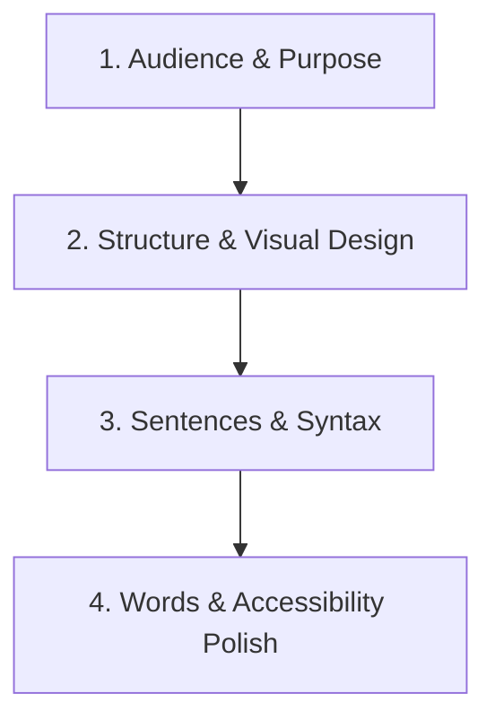

# Plain English – Guidelines and Writing Methodology for a Broad Audience

This skill is founded on international Plain Language standards (**ISO 24495-1:2023**), the US Plain Writing Act guidelines ([plainlanguage.gov](https://www.plainlanguage.gov)), the UK Government Digital Service (GDS) style guide, and the Plain English Campaign principles.

---

## 1. What Is Plain English?

> **Definition (Plain Language Action and Information Network & ISO 24495-1):**  
> *Communication is in plain language if its wording, structure, and design are so clear that the intended audience can easily find what they need, understand what they find, and use that information to fulfill their purpose.*

Writing in Plain English is **not** childish, simplistic, or unprofessional. It is the art of communicating important, nuanced, and complex information so that busy, diverse readers can grasp it on their first read.

---

## 2. The Five Core Principles of Plain English

### Principle 1: Focus Completely on Your Reader (Audience)
- **Know who is reading:** Assume readers are busy, distracted, and reading on varied devices (e.g., smartphones).
- **Match their reading level:** Target an average reading grade level of 7th–9th grade (Flesch-Kincaid Grade Level ≤ 8; Reading Ease score ≥ 60) for general public communication.
- **Explain unfamiliar ideas:** Never use an acronym, technical abbreviation, or specialized concept without explaining it immediately in everyday words.
- **Write for real human needs:** Answer the questions the reader actually has, not just the background history the writer wants to share.

### Principle 2: Make Purpose and Action Unmissable (Purpose & Action)
- **State the main point first (Bottom Line Up Front / BLUF):** Tell the reader what they need to know or do right away.
- **Highlight call-to-actions:** If the reader must apply, pay, choose, register, or change behavior, state the action, deadline, and steps prominently at the top—never bury it at the bottom of the page.
- **Cut background clutter:** Eliminate bureaucratic history, legislative backstories, and committee details that do not change what the reader must do.

### Principle 3: Organize for Easy Scanning (Information Architecture)
- **Inverted Pyramid structure:** Put the most important information first, followed by supporting details, and leave optional background for last.
- **Informative, question-based headings:** Use clear, descriptive headings—often phrased as questions readers ask (e.g., *"How do I apply?"* or *"Who qualifies?"* instead of *"Application Procedure Eligibility Criteria"*).
- **One main thought per paragraph:** Keep paragraphs short (typically 2 to 4 sentences).
- **Use bullet points and numbered lists:** Break lists of conditions, requirements, or steps into bullet points. Numbered lists are best when steps must follow a strict chronological order.
- **Visual breathing room:** Use white space, bold keywords for emphasis, and visual separation so text does not look like an intimidating wall of words.

### Principle 4: Write Short, Direct Sentences (Syntax & Flow)
- **Keep sentences short:** Aim for an average of 15–20 words per sentence. Express one idea per sentence.
- **Cure the "Noun Habit" (Nominalization Trap):** Replace stiff, clunky noun phrases with vibrant, natural verbs:
  - ❌ *"We will conduct an investigation of the complaint."* → ✅ *"We will investigate the complaint."*
  - ❌ *"Please make a selection from the options."* → ✅ *"Please choose an option."*
  - ❌ *"The committee reached a decision."* → ✅ *"The committee decided."*
- **Choose active voice over passive voice:** Put the actor before the action so readers immediately know who does what:
  - ❌ *"Your application will be reviewed by our team."* → ✅ *"Our team will review your application."*
  - ❌ *"The fee must be paid before access is granted."* → ✅ *"You must pay the fee before you can log in."*
  - ❌ *"Mistakes were made."* → ✅ *"We made a mistake."*
- **Address the reader directly:** Use second-person pronouns (*"you"*, *"your"*) for the reader and first-person (*"we"*, *"our"*, *"I"*) for your organization. This establishes a warm, transparent, and direct tone.

### Principle 5: Choose Everyday Words and Purge Bureaucratic Jargon (Vocabulary)
- **Use simple, familiar words:** Prefer everyday conversational words over stilted, pompous, or archaic vocabulary (*"help"* instead of *"facilitate"*; *"start"* instead of *"commence"*).
- **Avoid officialese, legalese, and corporate jargon:** Eliminate empty buzzwords like *"synergize"*, *"leverage"*, *"paradigm shift"*, *"touch base"*, and *"bandwidth"*.
- **Keep idioms culture-neutral:** Avoid slang, cultural metaphors, or regional idioms that may confuse non-native English speakers or international readers.

---

## 3. The "Gobbledygook" Buster – Words and Phrases to Replace

Bureaucratic writing, legal forms, and corporate memos often hide behind stuffy, inflated language. Use this conversion guide to replace wordy clutter with crisp Plain English:

| Pompous / Stilted Expression | Plain English Alternative |
| :--- | :--- |
| **accorded / afforded an opportunity** | given a chance, allowed |
| **acquire** | buy, get |
| **adjacent to** | next to, beside |
| **advise (in the sense of inform)** | tell, let you know |
| **affix your signature to** | sign |
| **allocate** | assign, give, divide |
| **ameliorate** | improve, help |
| **apprise** | inform, tell |
| **as per our previous conversation** | as we discussed |
| **at an early date / at your earliest convenience** | soon, promptly, by [date] |
| **at the present time / at this juncture** | now, currently |
| **commence / commencement** | start, begin / start |
| **comply with** | follow, meet |
| **deem** | consider, think, judge |
| **disseminate** | share, distribute, send out |
| **due to the fact that** | because, since |
| **endeavor to** | try to |
| **enclosed please find / attached hereto** | here is, I have attached |
| **expedite** | speed up, hurry |
| **facilitate** | help, make easier |
| **for the duration of** | during, while |
| **for the purpose of** | to, for |
| **forward** | send |
| **furnish** | give, provide, send |
| **has a requirement for** | needs |
| **in accordance with** | following, under, as stated in |
| **in addition to** | also, besides, as well as |
| **in close proximity to** | near, close to |
| **in conjunction with** | with, together with |
| **in excess of** | more than, over |
| **in lieu of** | instead of |
| **in order that / in order to** | so that / to |
| **in receipt of** | have received |
| **in the event that / in the event of** | if |
| **is applicable to** | applies to |
| **is authorized to** | may, can |
| **is of the opinion that** | thinks, believes |
| **it is incumbent upon you to** | you must |
| **magnitude** | size |
| **maximize / optimize** | make the most of, improve |
| **nevertheless** | even so, still, however |
| **notify** | let know, tell |
| **notwithstanding** | despite, even though |
| **numerous** | many |
| **obtain** | get |
| **pertaining to / regarding** | about, on |
| **prior to / subsequent to** | before / after |
| **promulgate** | publish, issue, announce |
| **pursuant to** | under, following |
| **remit / remittance** | pay, send / payment |
| **request** | ask for |
| **stipulate** | state, require |
| **terminate** | end, stop |
| **the undersigned** | I, me, we, us |
| **utilize / utilization** | use |
| **with reference to / with regard to** | about |

---

## 4. Plain English Editing Workflow

When evaluating, simplifying, or rewriting any piece of writing, follow this 4-step process:

1. **Audience and Purpose:**
   - Who will read this, and what do they want to know?
   - What single action must the reader take?
   - Cut out background history, internal policy trivia, or administrative context the reader does not need.
2. **Structure and Scannability:**
   - Move the main answer or outcome directly to the top (Bottom Line Up Front).
   - Add descriptive headings and subheadings (use question format where helpful).
   - Convert dense lists or multi-step conditions into bulleted or numbered lists.
3. **Sentences and Voice:**
   - Cut sentence length to an average of 15–20 words; express one thought at a time.
   - Convert passive sentences to active (*who is doing what?*).
   - Replace heavy noun-bloat (*"investigation of"*, *"implementation of"*) with active verbs (*"investigate"*, *"implement"*).
   - Speak directly to the reader using *"you"* and *"we"*.
4. **Vocabulary and Final Polish:**
   - Cross-check against the Gobbledygook Buster table to remove officialese and corporate speak.
   - Replace complex terms with everyday words.
   - Proofread for punctuation, clarity, and tone.

---

## 5. Plain English Checklist for General Readers

Before publishing or sending any communication to a general audience, check against these criteria:

- [ ] Is the primary takeaway or required action in the title or the very first paragraph?
- [ ] Will an everyday reader immediately understand what to do, how to do it, and the relevant deadlines?
- [ ] Does the text address the reader directly using *"you"* and the organization as *"we"*?
- [ ] Are active verbs used so the subject doing the action is always obvious?
- [ ] Have bureaucratic noun phrases (*"make an application"*, *"give consideration to"*) been turned into direct verbs (*"apply"*, *"consider"*)?
- [ ] Is the average sentence length under 20 words?
- [ ] Are complex conditions or series of requirements organized into bullet points?
- [ ] Are stuffy, inflated words (*utilize, pursuant to, commence, ascertain*) replaced with everyday equivalents?
- [ ] Are all unavoidable technical terms, legal phrases, or acronyms explained in plain, relatable language?
- [ ] Is the tone respectful, helpful, and free of cold bureaucratic jargon?
- [ ] Can someone scan the headings and bullet points in 15 seconds and grasp the core message?

---

## 6. Sources and References

This skill is founded upon official national plain language guidelines, statutory standards, international norms, and recognized clarity organizations:

1. **International Standards:**
   - **ISO 24495-1:2023:** *Plain language — Part 1: Governing principles and guidelines*. International Organization for Standardization ([iso.org/standard/79780.html](https://www.iso.org/standard/79780.html)).
   - **International Plain Language Federation (IPLF):** Plain language definition and professional standards ([iplfederation.org](https://www.iplfederation.org)).
2. **Official Government Plain Language Guidelines:**
   - **Plain Language Action and Information Network (PLAIN) / plainlanguage.gov:** *Federal Plain Language Guidelines* (implemented under the US Plain Writing Act of 2010, Public Law 111-274). ([plainlanguage.gov/guidelines/](https://www.plainlanguage.gov/guidelines/)).
   - **UK Government Digital Service (GDS):** *GOV.UK Style Guide & Content Design Principles* ([gov.uk/guidance/style-guide](https://www.gov.uk/guidance/style-guide)).
   - **Australian Government:** *Style Manual for Authoring and Editing Australian Government Information* ([stylemanual.gov.au](https://www.stylemanual.gov.au/)).
3. **Pivotal Clarity & Readability Manuals:**
   - **Plain English Campaign:** *How to Write in Plain English* and *The A to Z of Alternative Words* ([plainenglish.co.uk](https://www.plainenglish.co.uk)).
   - **Garner, Bryan A. (2001):** *Legal Writing in Plain English: A Text with Exercises*. Chicago: University of Chicago Press.
   - **Cutts, Martin (2020):** *Oxford Guide to Plain English* (5th ed.). Oxford: Oxford University Press.
   - **Redish, Janice (Ginny) (2012):** *Letting Go of the Words: Writing Web Content that Works* (2nd ed.). Morgan Kaufmann.

